# A&M Fashion (E-commerce) ERD

19 tables · 148 fields · 32 relationships. Columns: field name, data type, key, notes.

```mermaid
erDiagram
    roles {
        role_id INT PK "AUTO_INCREMENT"
        role_name VARCHAR(255) UK
    }
    users {
        user_id INT PK "AUTO_INCREMENT"
        password VARCHAR
        last_login DATETIME
        name VARCHAR(255)
        email VARCHAR(255) UK
        phone VARCHAR(50)
        address TEXT
        is_valid_email BOOLEAN
        role_id INT FK
        date_created DATETIME
        is_active BOOLEAN
    }
    suppliers {
        supplier_id INT PK "AUTO_INCREMENT"
        user_id INT FK,UK "OneToOne to users(user_id)"
        unread_counter INT
    }
    categories {
        category_id INT PK "AUTO_INCREMENT"
        short_id VARCHAR(255) UK
        main_category_name VARCHAR(255)
        sub_category_name VARCHAR(255) "NULLABLE"
        date_created DATETIME
        is_active BOOLEAN
        parent_category_id INT FK "NULLABLE, self reference to categories(category_id)"
    }
    products {
        product_id INT PK "AUTO_INCREMENT"
        catalog_number VARCHAR(255) UK
        name VARCHAR(255)
        description TEXT "NULLABLE"
        information TEXT "NULLABLE"
        price DECIMAL "DECIMAL(10,2)"
        tags TEXT "NULLABLE"
        fabric VARCHAR(255) "NULLABLE"
        category_id INT FK
        supplier_id INT FK "NULLABLE"
        date_created DATETIME
        is_active BOOLEAN
    }
    product_variants {
        variant_id INT PK "AUTO_INCREMENT"
        product_id INT FK
        color VARCHAR(100) "NULLABLE"
        size VARCHAR(100) "NULLABLE"
        quantity INT
        is_active BOOLEAN
    }
    product_images {
        image_id INT PK "AUTO_INCREMENT"
        product_id INT FK
        variant_id INT FK "NULLABLE"
        public_id VARCHAR(255) UK "NULLABLE"
        pending_delete_public_id VARCHAR(255) "NULLABLE"
        secure_url VARCHAR(1000)
        width INT "NULLABLE"
        height INT "NULLABLE"
        format VARCHAR(20)
        alt_text VARCHAR(255)
        display_order INT
        is_primary BOOLEAN
        is_active BOOLEAN
        date_created DATETIME
    }
    carts {
        cart_id INT PK "AUTO_INCREMENT"
        customer_id INT FK "NULLABLE"
        guest_id UUID UK "NULLABLE"
        total_price DECIMAL "DECIMAL(10,2)"
        date_created DATETIME
        date_updated DATETIME
    }
    cart_products {
        cart_product_id INT PK "AUTO_INCREMENT"
        cart_id INT FK
        variant_id INT FK
        quantity INT
        unit_price DECIMAL "DECIMAL(10,2)"
        total_price DECIMAL "DECIMAL(10,2)"
    }
    payments {
        payment_id INT PK "AUTO_INCREMENT"
        customer_id INT FK
        cart_id INT FK
        provider_order_id VARCHAR(64) UK
        provider_capture_id VARCHAR(64) UK "NULLABLE"
        idempotency_key UUID UK
        status VARCHAR(32)
        amount DECIMAL "DECIMAL(10,2)"
        currency VARCHAR(3)
        provider_response JSON
        date_created DATETIME
        date_updated DATETIME
    }
    payment_items {
        payment_item_id INT PK "AUTO_INCREMENT"
        payment_id INT FK
        product_id INT FK
        variant_id INT FK
        product_name VARCHAR(255)
        color VARCHAR(100) "NULLABLE"
        size VARCHAR(100) "NULLABLE"
        quantity INT
        unit_price DECIMAL "DECIMAL(10,2)"
        total_price DECIMAL "DECIMAL(10,2)"
    }
    orders {
        order_id INT PK "AUTO_INCREMENT"
        cart_id INT FK
        payment_id INT FK,UK "NULLABLE, OneToOne to payments(payment_id)"
        pickup_point_id INT FK "NULLABLE"
        customer_id INT FK
        total_price DECIMAL "DECIMAL(10,2)"
        order_status VARCHAR(100)
        date_created DATETIME
        date_updated DATETIME
        is_review BOOLEAN
    }
    order_items {
        order_item_id INT PK "AUTO_INCREMENT"
        order_id INT FK
        product_id INT FK
        variant_id INT FK
        product_name VARCHAR(255)
        color VARCHAR(100) "NULLABLE"
        size VARCHAR(100) "NULLABLE"
        quantity INT
        unit_price DECIMAL "DECIMAL(10,2)"
        total_price DECIMAL "DECIMAL(10,2)"
    }
    supplier_order_fulfillments {
        fulfillment_id INT PK "AUTO_INCREMENT"
        order_id INT FK
        supplier_id INT FK
        status VARCHAR(100)
        date_created DATETIME
        date_updated DATETIME
    }
    reviews {
        review_id INT PK "AUTO_INCREMENT"
        order_id INT FK
        product_id INT FK
        customer_id INT FK
        review_text TEXT
        stars INT "value must be 1-5"
        date_created DATETIME
    }
    notifications {
        notification_id INT PK "AUTO_INCREMENT"
        supplier_id INT FK
        order_id INT FK
        date_created DATETIME
        type VARCHAR(255)
        is_read BOOLEAN
    }
    pick_up_points {
        pick_up_point_id INT PK "AUTO_INCREMENT"
        lat DECIMAL "DECIMAL(10,7)"
        lng DECIMAL "DECIMAL(10,7)"
        name VARCHAR(255)
        description TEXT "NULLABLE"
        address TEXT "NULLABLE"
        date_created DATETIME
        is_active BOOLEAN
    }
    email_verification_tokens {
        token_id INT PK "AUTO_INCREMENT"
        user_id INT FK "references users(user_id)"
        token_hash VARCHAR(64) UK
        created_at DATETIME
        expires_at DATETIME
        used_at DATETIME "NULLABLE"
    }
    password_reset_tokens {
        token_id INT PK "AUTO_INCREMENT"
        user_id INT FK "references users(user_id)"
        token_hash VARCHAR(64) UK
        created_at DATETIME
        expires_at DATETIME
        used_at DATETIME "NULLABLE"
    }

    roles ||--o{ users : role_id
    users ||--o| suppliers : user_id
    users |o--o{ carts : customer_id
    users ||--o{ payments : customer_id
    users ||--o{ orders : customer_id
    users ||--o{ reviews : customer_id
    categories |o--o{ categories : parent_category_id
    categories ||--o{ products : category_id
    suppliers |o--o{ products : supplier_id
    products ||--o{ product_variants : product_id
    products ||--o{ product_images : product_id
    product_variants |o--o{ product_images : variant_id
    carts ||--o{ cart_products : cart_id
    product_variants ||--o{ cart_products : variant_id
    carts ||--o{ payments : cart_id
    payments ||--o{ payment_items : payment_id
    products ||--o{ payment_items : product_id
    product_variants ||--o{ payment_items : variant_id
    carts ||--o{ orders : cart_id
    payments |o--o| orders : payment_id
    pick_up_points |o--o{ orders : pickup_point_id
    orders ||--o{ order_items : order_id
    products ||--o{ order_items : product_id
    product_variants ||--o{ order_items : variant_id
    orders ||--o{ supplier_order_fulfillments : order_id
    suppliers ||--o{ supplier_order_fulfillments : supplier_id
    orders ||--o{ notifications : order_id
    suppliers ||--o{ notifications : supplier_id
    orders ||--o{ reviews : order_id
    products ||--o{ reviews : product_id
    users ||--o{ email_verification_tokens : user_id
    users ||--o{ password_reset_tokens : user_id
```

Mermaid uses UK for UNIQUE. Decimal precision and scale are shown in each decimal field's notes, for example DECIMAL(10,2), because the renderer does not accept a comma inside the type token. The SVG and PNG display the full decimal type in the data-type column and use fixed relationship marker geometry.
## Tables and notes

### `roles`

| Field name | Data type | Key | Notes |
|---|---|---|---|
| `role_id` | `INT` | PK | AUTO_INCREMENT |
| `role_name` | `VARCHAR(255)` | UNIQUE |  |

### `users`

| Field name | Data type | Key | Notes |
|---|---|---|---|
| `user_id` | `INT` | PK | AUTO_INCREMENT |
| `password` | `VARCHAR` |  |  |
| `last_login` | `DATETIME` |  |  |
| `name` | `VARCHAR(255)` |  |  |
| `email` | `VARCHAR(255)` | UNIQUE |  |
| `phone` | `VARCHAR(50)` |  |  |
| `address` | `TEXT` |  |  |
| `is_valid_email` | `BOOLEAN` |  |  |
| `role_id` | `INT` | FK |  |
| `date_created` | `DATETIME` |  |  |
| `is_active` | `BOOLEAN` |  |  |

### `email_verification_tokens`

| Field name | Data type | Key | Notes |
|---|---|---|---|
| `token_id` | `INT` | PK | AUTO_INCREMENT |
| `user_id` | `INT` | FK | references users(user_id) |
| `token_hash` | `VARCHAR(64)` | UNIQUE |  |
| `created_at` | `DATETIME` |  |  |
| `expires_at` | `DATETIME` |  |  |
| `used_at` | `DATETIME` |  | NULLABLE |

### `password_reset_tokens`

| Field name | Data type | Key | Notes |
|---|---|---|---|
| `token_id` | `INT` | PK | AUTO_INCREMENT |
| `user_id` | `INT` | FK | references users(user_id) |
| `token_hash` | `VARCHAR(64)` | UNIQUE |  |
| `created_at` | `DATETIME` |  |  |
| `expires_at` | `DATETIME` |  |  |
| `used_at` | `DATETIME` |  | NULLABLE |

### `suppliers`

| Field name | Data type | Key | Notes |
|---|---|---|---|
| `supplier_id` | `INT` | PK | AUTO_INCREMENT |
| `user_id` | `INT` | FK + UNIQUE | OneToOne to users(user_id) |
| `unread_counter` | `INT` |  |  |

- **Original non-negative integer validation:** `unread_counter >= 0`.

### `categories`

| Field name | Data type | Key | Notes |
|---|---|---|---|
| `category_id` | `INT` | PK | AUTO_INCREMENT |
| `short_id` | `VARCHAR(255)` | UNIQUE |  |
| `main_category_name` | `VARCHAR(255)` |  |  |
| `sub_category_name` | `VARCHAR(255)` |  | NULLABLE |
| `date_created` | `DATETIME` |  |  |
| `is_active` | `BOOLEAN` |  |  |
| `parent_category_id` | `INT` | FK | NULLABLE, self reference to categories(category_id) |

### `products`

| Field name | Data type | Key | Notes |
|---|---|---|---|
| `product_id` | `INT` | PK | AUTO_INCREMENT |
| `catalog_number` | `VARCHAR(255)` | UNIQUE |  |
| `name` | `VARCHAR(255)` |  |  |
| `description` | `TEXT` |  | NULLABLE |
| `information` | `TEXT` |  | NULLABLE |
| `price` | `DECIMAL(10,2)` |  |  |
| `tags` | `TEXT` |  | NULLABLE |
| `fabric` | `VARCHAR(255)` |  | NULLABLE |
| `category_id` | `INT` | FK |  |
| `supplier_id` | `INT` | FK | NULLABLE |
| `date_created` | `DATETIME` |  |  |
| `is_active` | `BOOLEAN` |  |  |

- **Table check / validation:** price >= 0.

### `product_variants`

| Field name | Data type | Key | Notes |
|---|---|---|---|
| `variant_id` | `INT` | PK | AUTO_INCREMENT |
| `product_id` | `INT` | FK |  |
| `color` | `VARCHAR(100)` |  | NULLABLE |
| `size` | `VARCHAR(100)` |  | NULLABLE |
| `quantity` | `INT` |  |  |
| `is_active` | `BOOLEAN` |  |  |

- **Table constraint:** `UNIQUE(product_id, color, size)` — `unique_product_color_size_variant`.
- **Table check / validation:** quantity >= 0.

### `product_images`

| Field name | Data type | Key | Notes |
|---|---|---|---|
| `image_id` | `INT` | PK | AUTO_INCREMENT |
| `product_id` | `INT` | FK |  |
| `variant_id` | `INT` | FK | NULLABLE |
| `public_id` | `VARCHAR(255)` | UNIQUE | NULLABLE |
| `pending_delete_public_id` | `VARCHAR(255)` |  | NULLABLE |
| `secure_url` | `VARCHAR(1000)` |  |  |
| `width` | `INT` |  | NULLABLE |
| `height` | `INT` |  | NULLABLE |
| `format` | `VARCHAR(20)` |  |  |
| `alt_text` | `VARCHAR(255)` |  |  |
| `display_order` | `INT` |  |  |
| `is_primary` | `BOOLEAN` |  |  |
| `is_active` | `BOOLEAN` |  |  |
| `date_created` | `DATETIME` |  |  |

- **Table constraint:** `UNIQUE(product_id) WHERE is_primary = true` — `one_primary_image_per_product`.
- **Original non-negative integer validation:** `width >= 0`; `height >= 0`; `display_order >= 0`.

### `carts`

| Field name | Data type | Key | Notes |
|---|---|---|---|
| `cart_id` | `INT` | PK | AUTO_INCREMENT |
| `customer_id` | `INT` | FK | NULLABLE |
| `guest_id` | `UUID` | UNIQUE | NULLABLE |
| `total_price` | `DECIMAL(10,2)` |  |  |
| `date_created` | `DATETIME` |  |  |
| `date_updated` | `DATETIME` |  |  |

- **Table check / validation:** Exactly one owner: either customer_id OR guest_id must exist, not both.

### `cart_products`

| Field name | Data type | Key | Notes |
|---|---|---|---|
| `cart_product_id` | `INT` | PK | AUTO_INCREMENT |
| `cart_id` | `INT` | FK |  |
| `variant_id` | `INT` | FK |  |
| `quantity` | `INT` |  |  |
| `unit_price` | `DECIMAL(10,2)` |  |  |
| `total_price` | `DECIMAL(10,2)` |  |  |

- **Table constraint:** `UNIQUE(cart_id, variant_id)` — `one_cart_item_per_variant`.
- **Original non-negative integer validation:** `quantity >= 0`.

### `payments`

| Field name | Data type | Key | Notes |
|---|---|---|---|
| `payment_id` | `INT` | PK | AUTO_INCREMENT |
| `customer_id` | `INT` | FK |  |
| `cart_id` | `INT` | FK |  |
| `provider_order_id` | `VARCHAR(64)` | UNIQUE |  |
| `provider_capture_id` | `VARCHAR(64)` | UNIQUE | NULLABLE |
| `idempotency_key` | `UUID` | UNIQUE |  |
| `status` | `VARCHAR(32)` |  |  |
| `amount` | `DECIMAL(10,2)` |  |  |
| `currency` | `VARCHAR(3)` |  |  |
| `provider_response` | `JSON` |  |  |
| `date_created` | `DATETIME` |  |  |
| `date_updated` | `DATETIME` |  |  |

### `payment_items`

| Field name | Data type | Key | Notes |
|---|---|---|---|
| `payment_item_id` | `INT` | PK | AUTO_INCREMENT |
| `payment_id` | `INT` | FK |  |
| `product_id` | `INT` | FK |  |
| `variant_id` | `INT` | FK |  |
| `product_name` | `VARCHAR(255)` |  |  |
| `color` | `VARCHAR(100)` |  | NULLABLE |
| `size` | `VARCHAR(100)` |  | NULLABLE |
| `quantity` | `INT` |  |  |
| `unit_price` | `DECIMAL(10,2)` |  |  |
| `total_price` | `DECIMAL(10,2)` |  |  |

- **Table constraint:** `UNIQUE(payment_id, variant_id)` — `one_payment_item_per_variant`.
- **Original non-negative integer validation:** `quantity >= 0`.

### `orders`

| Field name | Data type | Key | Notes |
|---|---|---|---|
| `order_id` | `INT` | PK | AUTO_INCREMENT |
| `cart_id` | `INT` | FK |  |
| `payment_id` | `INT` | FK + UNIQUE | NULLABLE, OneToOne to payments(payment_id) |
| `pickup_point_id` | `INT` | FK | NULLABLE |
| `customer_id` | `INT` | FK |  |
| `total_price` | `DECIMAL(10,2)` |  |  |
| `order_status` | `VARCHAR(100)` |  |  |
| `date_created` | `DATETIME` |  |  |
| `date_updated` | `DATETIME` |  |  |
| `is_review` | `BOOLEAN` |  |  |

### `order_items`

| Field name | Data type | Key | Notes |
|---|---|---|---|
| `order_item_id` | `INT` | PK | AUTO_INCREMENT |
| `order_id` | `INT` | FK |  |
| `product_id` | `INT` | FK |  |
| `variant_id` | `INT` | FK |  |
| `product_name` | `VARCHAR(255)` |  |  |
| `color` | `VARCHAR(100)` |  | NULLABLE |
| `size` | `VARCHAR(100)` |  | NULLABLE |
| `quantity` | `INT` |  |  |
| `unit_price` | `DECIMAL(10,2)` |  |  |
| `total_price` | `DECIMAL(10,2)` |  |  |

- **Table constraint:** `UNIQUE(order_id, variant_id)` — `one_order_item_per_variant`.
- **Original non-negative integer validation:** `quantity >= 0`.

### `supplier_order_fulfillments`

| Field name | Data type | Key | Notes |
|---|---|---|---|
| `fulfillment_id` | `INT` | PK | AUTO_INCREMENT |
| `order_id` | `INT` | FK |  |
| `supplier_id` | `INT` | FK |  |
| `status` | `VARCHAR(100)` |  |  |
| `date_created` | `DATETIME` |  |  |
| `date_updated` | `DATETIME` |  |  |

- **Table constraint:** `UNIQUE(order_id, supplier_id)` — `unique_order_supplier_fulfillment`.

### `reviews`

| Field name | Data type | Key | Notes |
|---|---|---|---|
| `review_id` | `INT` | PK | AUTO_INCREMENT |
| `order_id` | `INT` | FK |  |
| `product_id` | `INT` | FK |  |
| `customer_id` | `INT` | FK |  |
| `review_text` | `TEXT` |  |  |
| `stars` | `INT` |  | value must be 1-5 |
| `date_created` | `DATETIME` |  |  |

- **Table constraint:** `UNIQUE(order_id, product_id, customer_id)` — `unique_order_product_customer_review`.

### `notifications`

| Field name | Data type | Key | Notes |
|---|---|---|---|
| `notification_id` | `INT` | PK | AUTO_INCREMENT |
| `supplier_id` | `INT` | FK |  |
| `order_id` | `INT` | FK |  |
| `date_created` | `DATETIME` |  |  |
| `type` | `VARCHAR(255)` |  |  |
| `is_read` | `BOOLEAN` |  |  |

- **Table constraint:** `UNIQUE(supplier_id, order_id, type)` — `unique_supplier_order_notification_type`.

### `pick_up_points`

| Field name | Data type | Key | Notes |
|---|---|---|---|
| `pick_up_point_id` | `INT` | PK | AUTO_INCREMENT |
| `lat` | `DECIMAL(10,7)` |  |  |
| `lng` | `DECIMAL(10,7)` |  |  |
| `name` | `VARCHAR(255)` |  |  |
| `description` | `TEXT` |  | NULLABLE |
| `address` | `TEXT` |  | NULLABLE |
| `date_created` | `DATETIME` |  |  |
| `is_active` | `BOOLEAN` |  |  |

`users.password` is shown as `VARCHAR` because no maximum length was supplied. `AUTO_INCREMENT` is the requested conceptual annotation, not engine-specific DDL. Fields converted from positive integer types retain their original non-negative validation as notes.

## Relationships

| Parent | Child FK | Referenced PK | Cardinality per child | Children per parent |
|---|---|---|---|---|
| `roles` | `users.role_id` | `roles.role_id` | 1 | 0..many |
| `users` | `suppliers.user_id` | `users.user_id` | 1 | 0..1 |
| `users` | `carts.customer_id` | `users.user_id` | 0..1 | 0..many |
| `users` | `payments.customer_id` | `users.user_id` | 1 | 0..many |
| `users` | `orders.customer_id` | `users.user_id` | 1 | 0..many |
| `users` | `reviews.customer_id` | `users.user_id` | 1 | 0..many |
| `categories` | `categories.parent_category_id` | `categories.category_id` | 0..1 | 0..many |
| `categories` | `products.category_id` | `categories.category_id` | 1 | 0..many |
| `suppliers` | `products.supplier_id` | `suppliers.supplier_id` | 0..1 | 0..many |
| `products` | `product_variants.product_id` | `products.product_id` | 1 | 0..many |
| `products` | `product_images.product_id` | `products.product_id` | 1 | 0..many |
| `product_variants` | `product_images.variant_id` | `product_variants.variant_id` | 0..1 | 0..many |
| `carts` | `cart_products.cart_id` | `carts.cart_id` | 1 | 0..many |
| `product_variants` | `cart_products.variant_id` | `product_variants.variant_id` | 1 | 0..many |
| `carts` | `payments.cart_id` | `carts.cart_id` | 1 | 0..many |
| `payments` | `payment_items.payment_id` | `payments.payment_id` | 1 | 0..many |
| `products` | `payment_items.product_id` | `products.product_id` | 1 | 0..many |
| `product_variants` | `payment_items.variant_id` | `product_variants.variant_id` | 1 | 0..many |
| `carts` | `orders.cart_id` | `carts.cart_id` | 1 | 0..many |
| `payments` | `orders.payment_id` | `payments.payment_id` | 0..1 | 0..1 |
| `pick_up_points` | `orders.pickup_point_id` | `pick_up_points.pick_up_point_id` | 0..1 | 0..many |
| `orders` | `order_items.order_id` | `orders.order_id` | 1 | 0..many |
| `products` | `order_items.product_id` | `products.product_id` | 1 | 0..many |
| `product_variants` | `order_items.variant_id` | `product_variants.variant_id` | 1 | 0..many |
| `orders` | `supplier_order_fulfillments.order_id` | `orders.order_id` | 1 | 0..many |
| `suppliers` | `supplier_order_fulfillments.supplier_id` | `suppliers.supplier_id` | 1 | 0..many |
| `orders` | `notifications.order_id` | `orders.order_id` | 1 | 0..many |
| `suppliers` | `notifications.supplier_id` | `suppliers.supplier_id` | 1 | 0..many |
| `orders` | `reviews.order_id` | `orders.order_id` | 1 | 0..many |
| `products` | `reviews.product_id` | `products.product_id` | 1 | 0..many |
| `users` | `email_verification_tokens.user_id` | `users.user_id` | 1 | 0..many |
| `users` | `password_reset_tokens.user_id` | `users.user_id` | 1 | 0..many |
