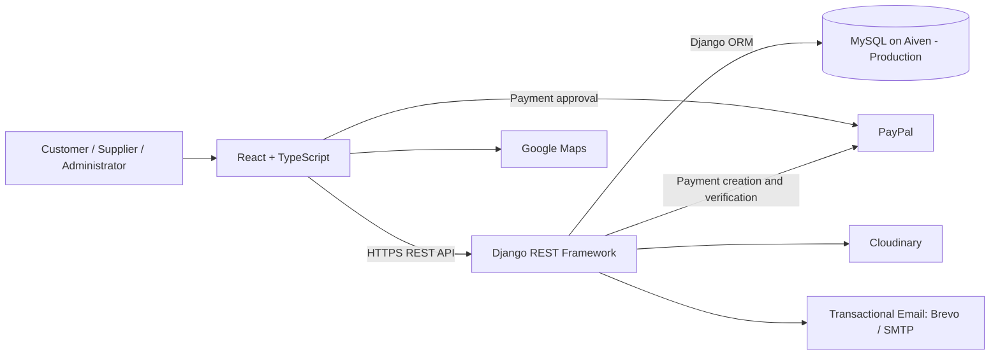

# A&M Fashion — E-Commerce Platform with PayPal and Google Maps Integrations

## Project Overview, Key Features, User Workflows by Role, and Local Backend and Frontend Setup

This README is the entry point for our degree final project. It covers the application, repository structure and architecture, key features, customer, supplier and administrator workflows, third-party integrations, and security measures. It also provides local setup instructions for both the backend and frontend, followed by a project summary and reflection. Use the table of contents to navigate directly to a topic.

<a id="overview"></a>
## 1. Project Overview and Links

**A&M Fashion** is a fashion e-commerce platform connecting customers, suppliers, and administrators. Customers can browse the catalogue, select sizes and colors, manage a shopping cart, choose a pickup point through Google Maps, pay through PayPal, and track their orders. Suppliers manage their products and their share of each order, while administrators manage store resources and operations.

| Resource | Link |
|---|---|
| Customer storefront | [A&M Fashion — Store](https://am-fashion.netlify.app/app) |
| Administrator and supplier interface | [A&M Fashion — Management](https://am-fashion.netlify.app/admin) |
| Source code | [GitHub Repository](https://github.com/morielsh57/A-M) |
| Interactive backend API documentation | [Backend API — Swagger](https://am-fashion-backend.onrender.com/api/docs) |
| Project task board | [GitHub Projects](https://github.com/users/morielsh57/projects/2/views/1) |

Protected operations require authentication with an appropriate role. Administrators and suppliers share the management interface, with pages and permissions tailored to their roles.

## Table of Contents

- [1. Project Overview and Links](#overview)
- [2. Team and Development Workflow](#team)
- [3. Repository Structure and Architecture](#architecture)
- [4. Key Features](#features)
- [5. User Workflows by Role](#roles)
- [6. Third-Party Integrations](#integrations)
- [7. Security and Data Integrity](#security)
- [8. Running the Project Locally](#local)
- [9. Project Summary and Reflection](#reflection)

<a id="team"></a>
## 2. Team and Development Workflow

The project was developed by **Amit and Moriel**, both working as **full-stack developers**. Moriel primarily focused on the frontend and also contributed to the backend; Amit primarily focused on the backend and also contributed to the frontend. We worked collaboratively throughout the project and divided tasks equally, as documented on the project board.

Tasks were managed in [GitHub Projects](https://github.com/users/morielsh57/projects/2/views/1). Each task was linked to a pull request describing the code changes and their rationale. Approval from the other team member was required before merging, providing mutual code review and shared understanding of both parts of the system. The [project pull requests](https://github.com/morielsh57/A-M/pulls?q=is%3Apr) complement the task board as a record of this work.

The [GitHub Actions workflow](.github/workflows/main.yaml) runs backend checks and tests, as well as frontend type checking and production builds.

<a id="architecture"></a>
## 3. Repository Structure and Architecture

```text
A-M/
├── README.md                 Project overview and setup guide
├── Architecture/
│   ├── AM_Fashion_ERD.png    Database diagram with color-coded domain groups
│   ├── AM_Fashion_ERD.md     Data model explanations
│   └── Software.md           Technologies, architecture, and system workflows
├── frontend/                 Customer, administrator, and supplier interfaces
│   ├── src/app/              Routing, route guards, and application infrastructure
│   ├── src/components/       Domain-specific pages and components
│   ├── src/shared/           API client, shared state, layouts, and utilities
│   ├── src/assets/           Images and design assets
│   ├── src/types/            Type definitions
│   └── README.md             Frontend instructions
├── backend/                  API, business logic, and database access
│   ├── config/               Settings, URL routing, and server infrastructure
│   ├── accounts/             Users, roles, authentication, and email verification
│   ├── catalogue/            Categories and subcategories
│   ├── products/             Products, variants, images, and inventory
│   ├── carts/                Shopping carts
│   ├── payments/             Payments and PayPal integration
│   ├── orders/               Orders and supplier fulfillment
│   ├── reviews/              Reviews and ratings
│   ├── notifications/        Supplier notifications
│   ├── pickup_points/        Pickup points and location-based searches
│   └── API_STANDARDS.md       API conventions
└── .github/                  CI workflows
```

### Technology Stack

| Layer | Technologies and responsibilities |
|---|---|
| Frontend | React 18, TypeScript, and Vite; React Router for navigation, Redux Toolkit for shared state, and Axios for API communication. Styling uses SCSS and UI component libraries. |
| Backend | Python, Django, and Django REST Framework; a versioned API under `/api/v1`, organized into domain-specific applications. Models define data, serializers validate input, views and permission classes handle requests and authorization, and services implement business logic. |
| Database | MySQL hosted on [Aiven](https://aiven.io/mysql) in production, accessed through the Django ORM. Schema changes are managed through migrations. |



The frontend presents information and sends requests. The backend enforces authorization, calculates prices, checks inventory, and creates orders. The frontend does not access the database directly. In production, the frontend is hosted on Netlify, the backend API on Render, and the MySQL database on [Aiven](https://aiven.io/mysql).

Detailed documentation of the technologies, architectural decisions, development tools, and system workflows is available in [Architecture/Software.md](Architecture/Software.md). Request, response, and error conventions are documented in [Backend API Standards](backend/API_STANDARDS.md).

### ERD — Physical Database Structure

[View the ERD image, organized into color-coded domain groups](Architecture/AM_Fashion_ERD.png).

Our ERD represents the **physical structure of the project's database**, including tables, fields, data types, keys, relationships, and constraints. It reflects the flexibility allowed by the database, even where application workflows and business logic impose stricter requirements. Two key examples illustrate this distinction:

1. **Order ↔ Payment:** In the checkout workflow, an order is created after a successful payment, so the business relationship is one-to-one. At the database level, `payment_id` is nullable within a `OneToOne` relationship, represented as `0..1` on both sides of the physical ERD: an order may have no associated payment, and a payment may have no associated order. The diagram notes identify the relationship as OneToOne and state that it is required during checkout. The backend requires a completed payment belonging to the customer before creating an order.
2. **Pickup Point ↔ Order:** An order's pickup-point reference is nullable in the database and therefore optional in the ERD. During checkout, however, the customer must select a pickup point, and the backend requires an active pickup-point ID before creating the order. A single pickup point can serve many orders.

This database-level optionality preserves flexibility for intermediate states and future extensions. The frontend and backend enforce the requirements of the current checkout workflow beyond the constraints of the physical schema.

<a id="features"></a>
## 4. Key Features

- **Accounts and authorization:** Registration, branded email verification, login, token refresh, profile management, and password changes, with role-based and ownership-based access control.
- **Fashion catalogue:** Categories and subcategories, search and autocomplete, pagination, and product pages with images, prices, descriptions, sizes, colors, and reviews. Inventory is tracked per size/color variant.
- **Shopping carts:** Guest and authenticated carts, quantity updates and item removal, guest-cart merging after login, and checkout of selected items.
- **Google Maps checkout integration:** Pickup-point searches around the customer's saved address or another location, branded map markers, and pickup-point selection.
- **PayPal checkout integration:** Backend payment creation, customer approval through PayPal, server-side capture verification, and order creation following successful payment.
- **Orders and inventory:** Order history, saved purchase details, status tracking, and inventory adjustments on order creation, cancellation, and reactivation.
- **Supplier fulfillment:** Each supplier sees and completes their own portion of an order; the overall order completes when all supplier fulfillments are completed.
- **Purchase-verified reviews:** Ratings and reviews for products from completed orders, editing of owned reviews, and average product ratings.
- **Management and notifications:** Product, image, category, user, order, and pickup-point management, with supplier notifications for new and cancelled orders.
- **Responsive interfaces:** Storefront and management layouts adapt to desktop and mobile devices, with loading states, error messages, and action feedback.

<a id="roles"></a>
## 5. User Workflows by Role

### Guest and Customer — From Product Discovery to Order Fulfillment

1. **Browse and select products:** Guests can browse the catalogue, search for products, read reviews, and select an available size/color variant.
2. **Manage the cart:** Add items, change quantities, and select which items to purchase. Adding an item does not reserve stock; availability is checked again later.
3. **Register and sign in:** Registration triggers a personalized, branded verification email with an activation link. The account remains inactive until the email address is verified. Checkout requires authentication; the guest cart is merged into the customer cart, subject to stock availability.
4. **Choose a pickup point:** Checkout loads pickup points around the address saved in the customer's profile. Customers can search for another address (for example: Ramat Gan College) or select a location on the map, then choose a point through its marker or the accompanying list.
5. **Pay:** The customer approves the purchase through PayPal. The backend verifies the payment, and the application creates an order linked to that payment and the selected pickup point.
6. **Review the purchase:** Order details are displayed. Purchased items are removed from the cart, while unselected items are retained. Customers can view their order history and each order's status.
7. **Manage the profile and submit reviews:** Customers can update personal details and change their password. Once an order is completed, they can rate and review purchased products and edit their existing reviews.

The main order statuses are `Pending`, `Completed`, and `Cancelled`. **Payment completion and order fulfillment are separate states:** a new order is created as Pending after successful payment, and fulfillment is managed afterward.

### Supplier — Product Management and Order Fulfillment

1. The supplier signs in through the [management interface](https://am-fashion.netlify.app/admin) and sees a dashboard and navigation appropriate to their role.
2. They view assigned products, create products for themselves, and update details, prices, variants, inventory, active states, and images.
3. They receive notifications about new and cancelled orders. The interface polls for notifications and displays their read status.
4. Order lists and details show only the supplier's items, subtotal, fulfillment status, and pickup information, excluding customer and payment details.
5. After fulfilling their portion of a pending order, the supplier marks it as Completed. They cannot complete another supplier's portion; completing all supplier fulfillments completes the overall order.
6. They can edit their profile and change their password. Product and variant deletion is restricted to administrators.

### Administrator — Store and System Management

Administrators sign in through the same management interface and can:

- View the dashboard and business activity summaries.
- Manage products, prices, sizes, colors, inventory, images, and active states.
- Manage categories, subcategories, customer, supplier, and administrator accounts, and pickup points.
- View orders, search and filter by status, inspect details, and update statuses.
- Cancel orders with inventory restoration or reactivate cancelled orders subject to stock availability; backend services synchronize supplier fulfillments accordingly.
- Edit their profile and change their password.

The backend rejects order deletion to preserve business history. Deletion of referenced resources is subject to database relationship restrictions; products can be deactivated when deletion is disallowed.

<a id="integrations"></a>
## 6. Third-Party Integrations

### Google Maps — Pickup-Point Search and Selection

Google Maps is integrated directly into checkout. The application uses Geocoding to convert the customer's saved home address into coordinates, centers the map on that location, and requests active pickup points from the backend within the configured radius. **The current search radius sent by the code is 3 km**, defined by `PICKUP_SEARCH_RADIUS_KM` in [CheckoutDelivery.utils.ts](frontend/src/components/client/checkout/checkout-delivery/CheckoutDelivery.utils.ts).

Customers can search for other addresses or places, or click a location on the map, to load pickup points around the new location. Points are displayed as **custom markers featuring the store logo**. Selecting a marker reveals its details and selects the pickup point; the same points are also available in a list alongside the map.

**Example for evaluators:** Search for `Ramat Gan College` in checkout to explore pickup points around our college. Results depend on the active pickup points configured in the system and the search radius. Pickup points are store-managed backend data; Google Maps provides the map and location lookup.

If the saved address cannot be located, customers can search manually. Loading and error states cover address lookup, map loading, and pickup-point retrieval.

### PayPal — Payment Processing and Server-Side Verification

The integration combines the PayPal React SDK in the frontend with the PayPal REST API in the backend:

1. The backend validates selected items and stock and calculates the payment amount from product prices rather than trusting a browser-supplied total.
2. It creates a PayPal order and stores a local payment record with snapshots of the items and prices.
3. The customer approves the payment through PayPal.
4. The backend captures the payment and verifies its completed status, amount, and currency against the local record.
5. The frontend requests a store order using the payment ID and selected pickup point. The backend checks ownership, payment completion, inventory, and the active pickup point, then creates the order and updates stock within a database transaction.

Idempotency keys and checks for existing payments and orders handle repeated requests without creating another store order for the same payment. PayPal handles payment-card details; our application stores payment identifiers and transaction information rather than card details. Both local and production uses matching PayPal Sandbox credentials in the frontend and backend.

### Transactional Email — Personalized Verification Messages via Brevo / SMTP

Email delivery is another external-service integration. When a customer registers, the backend generates a verification token and renders a **custom A&M Fashion HTML email**, personalized with the customer's name. The message includes the store branding, a styled verification button, and information about the link's validity and single-use restriction. A plain-text alternative is also provided.

The delivery service supports **Brevo's transactional email API** or a configured **SMTP provider**, selected through `EMAIL_PROVIDER`. With Brevo, the backend sends the recipient, subject, HTML content, and plain-text content to the external API using a server-side API key. With SMTP, Django sends a multipart email through the configured mail service. SMTP is the delivery protocol; the external SMTP provider performs delivery.

The account remains inactive until the customer follows the verification link successfully. The same email infrastructure supports branded password-reset messages and verification-email resend operations in the backend.

Implementation references: [email delivery service](backend/accounts/email_service.py), [verification email template](backend/accounts/templates/accounts/email/verify_email.html), and [account services](backend/accounts/services.py).

### Additional Services

- **[Aiven for MySQL](https://aiven.io/mysql):** Hosts the production relational database containing application data, including users, products, inventory, carts, payments, orders, reviews, notifications, and pickup points. The Render-hosted backend connects to Aiven through the Django ORM using database connection settings supplied through environment variables. Product-image files are stored separately in Cloudinary; their metadata is stored in MySQL.
- **Cloudinary:** Product-image storage and delivery. Upload, replacement, and deletion are performed through the backend, with image metadata stored in the database.
- **Netlify and Render:** The deployed frontend is hosted on Netlify and the API on Render. The CI workflow triggers the configured Render deployment hook after successful backend checks on pushes to main.

<a id="security"></a>
## 7. Security and Data Integrity

### Authentication, Tokens, and Authorization

- **JWT:** Protected requests use an access token in the `Authorization: Bearer` header. Default lifetimes are 15 minutes for access tokens and 7 days for refresh tokens, configurable through environment variables.
- **Token refresh:** Axios handles automatic refresh. The backend rotates refresh tokens and blacklists the previous token to prevent reuse. Concurrent `401` responses within the same browser tab use **deduplication** through a shared `refreshPromise`, so requests waiting during an active refresh share a single refresh request. Waiting requests retry with the same new access token, and each request is retried at most once. See the [Axios refresh and retry implementation](frontend/src/shared/api/axios.ts).
- **Token revocation:** Logout blacklists the refresh token. Password changes and resets revoke the user's refresh tokens; JWT authentication also checks for password changes.
- **Role and ownership checks:** Beyond frontend route guards, the backend validates authentication, roles, and resource ownership. Supplier queries are scoped to their products and order items; customers access their own orders and reviews.
- **Email verification:** New accounts remain inactive until verified. Verification and password-reset tokens are randomly generated, expire, and are stored as SHA-256 hashes. Token consumption prevents reuse. Resend and reset requests are rate-limited.

### Passwords and Sensitive Information

Passwords are stored using **Django's salted password-hashing mechanism**, rather than plaintext or reversible encryption. Password creation and updates use `set_password`, and authentication uses Django's password-checking mechanisms. Validators check minimum length, common passwords, entirely numeric passwords, and similarity to user attributes.

Server secrets, including database credentials, the PayPal Client Secret, and the Brevo API key, are read from environment variables and are not needed in browser code. Frontend `REACT_APP_` variables are included in the build and are accessible to users; they must contain only client-side configuration such as the PayPal Client ID and Maps key, never server secrets.

### SQL Injection, XSS, and Transport Security

| Area | Implemented measures |
|---|---|
| SQL Injection | Business operations access the database through the Django ORM, which parameterizes values instead of concatenating user input into SQL. Serializers validate types, values, and fields before business operations. |
| XSS | React escapes values rendered as text. The frontend code does not use `dangerouslySetInnerHTML` to display user input. Server-side validation complements interface validation. |
| Transport | The deployed site and API use HTTPS. The documented local setup also uses HTTPS for both services. Allowed CORS origins and trusted CSRF origins are configured; session and CSRF cookies are marked Secure outside DEBUG mode. |
| Purchase integrity | The server calculates prices and verifies payment ownership, capture status, amount, and currency. Inventory and pickup-point validity are checked before order creation. |
| Data consistency | Transactions, row locking for sensitive operations, foreign keys, and uniqueness constraints protect inventory, order, and cart operations. Orders retain historical snapshots of purchased items and prices. |

<a id="local"></a>
## 8. Running the Project Locally

The existing backend instructions below. Frontend instructions follow and reflect the current scripts and configuration. Run the two services in separate terminal windows.
To fully run the application you'll need both backend and frontend `.env` files. Please contact the owners of the application before trying to run the application.

## Running the Backend Locally

### Windows

```powershell
cd backend
```

For the first local setup, run:

```powershell
.\venv\Scripts\Activate.ps1
python -m pip install -r requirements.txt
python manage.py check
python manage.py migrate
```

Start the backend server:

```powershell
python -m uvicorn config.asgi:application --host 127.0.0.1 --port 8000 --ssl-keyfile .certs\localhost-key.pem --ssl-certfile .certs\localhost-cert.pem
```

For future runs on Windows, only activate the virtual environment and start the server:

```powershell
.\venv\Scripts\Activate.ps1
python -m uvicorn config.asgi:application --host 127.0.0.1 --port 8000 --ssl-keyfile .certs\localhost-key.pem --ssl-certfile .certs\localhost-cert.pem
```

### Mac/Linux

```bash
cd backend
```

For the first local setup, run:

```bash
source venv/bin/activate
python -m pip install -r requirements.txt
python manage.py check
python manage.py migrate
```

Start the backend server:

```bash
python -m uvicorn config.asgi:application --host 127.0.0.1 --port 8000 --ssl-keyfile .certs/localhost-key.pem --ssl-certfile .certs/localhost-cert.pem
```

For future runs on Mac/Linux, only activate the virtual environment and start the server:

```bash
source venv/bin/activate
python -m uvicorn config.asgi:application --host 127.0.0.1 --port 8000 --ssl-keyfile .certs/localhost-key.pem --ssl-certfile .certs/localhost-cert.pem
```

### Health Check

To verify that the backend is running, open this URL in the browser:

```text
https://localhost:8000/api/v1/health
```

The response should include:

```json
{
  "success": true,
  "data": {
    "status": "ok"
  }
}
```

### Running the Frontend Locally

The frontend currently uses Vite.

**Prerequisites:** Node.js and npm. CI checks Node.js 20 and 22; use Node.js 22 for local setup.

1. In a separate terminal, install dependencies from the repository root:

   ```bash
   cd frontend
   npm install
   ```

2. Start the development server with HTTPS:

   ```bash
   npm run start:ssl
   ```

3. Open the interfaces:

   - Storefront: [https://localhost:3001/app](https://localhost:3001/app)
   - Administrator and supplier interface: [https://localhost:3001/admin](https://localhost:3001/admin)

Vite uses port `3001` with `strictPort`, so the port must be available. The frontend SSL plugin generates a local development certificate; ensure your browser accepts the development certificates for both services. The backend's allowed-origin configuration must include `https://localhost:3001`.

For subsequent runs, execute `npm run start:ssl` from `frontend`, provided dependencies have not changed. Restart the frontend server after changing environment variables.

**Verify the setup:** Confirm that the backend health endpoint returns `status: ok`, the storefront loads products, and login works. To check the integrations, open checkout, search for a map location, and make a test purchase with a PayPal Sandbox account.

To check TypeScript types and create a production build:

```bash
npm run build
```

<a id="reflection"></a>
## 9. Project Summary and Reflection

### Outcome at the End of the Semester

A&M Fashion combines an online fashion store with supplier and administrator management interfaces. It brings together product variants, shopping carts, map-based pickup selection, PayPal payments, orders, inventory, and purchase-verified reviews. Amit and Moriel worked together across the frontend, backend, and database, supported by task tracking and mutual code review.

### Key Engineering Challenges and Implemented Solutions

The following engineering challenges are reflected in the implementation and project documentation:

| Challenge | Implemented solution |
|---|---|
| Frontend/backend coordination | A versioned API, consistent request, response, and error conventions, Swagger documentation, and clear domain boundaries. |
| Payment, order, and inventory consistency | Server-side capture verification, purchase snapshots, repeated stock checks, transactions, and idempotent handling of repeated requests. |
| Orders involving multiple suppliers | Separate fulfillment records for each supplier, ownership-scoped data, and overall completion when all supplier fulfillments are completed. |
| Location-based pickup selection | Geocoding of saved addresses and new searches, searches within a defined radius, branded markers, and error handling. |
| Authorization and business-history preservation | Backend role and ownership checks, protected relationships, rejection of order deletion, and purchase-time snapshots of product details and prices. |

### What We Would Add with More Time

- **Commerce and interface improvements:** Automatic refunds and recovery between payment capture and order creation, password-reset and verification-resend forms, customer-facing order cancellation, advanced catalogue filtering and sorting controls, and end-to-end tests for purchase and supplier workflows.
- **Stronger token storage and browser security:** Authentication tokens currently use `localStorage`. With more time, we would keep access tokens only in application memory and store refresh tokens in `HttpOnly`, `Secure` cookies to reduce persistent token exposure and prevent JavaScript from reading the refresh token. Cookie-based refresh requests would use credentials with explicitly allowed CORS origins, an appropriate `SameSite` policy, CSRF-token validation, and server-side origin checks to mitigate CSRF. 

### Use of Artificial Intelligence

We used AI throughout development to help write well-structured, maintainable code, support our mutual code reviews, develop automated tests, implement integrations, and investigate and resolve bugs. It also helped us evaluate the overall system architecture by comparing alternative approaches and discussing their advantages, disadvantages, and trade-offs. These discussions informed our selection of the current architecture. We reviewed AI-generated suggestions against the project requirements and implementation, while retaining responsibility for the final design decisions, code quality, and correctness.
